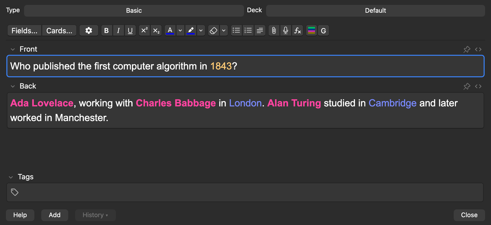
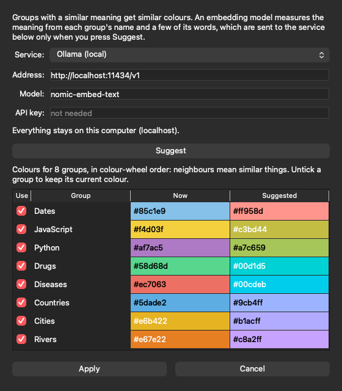
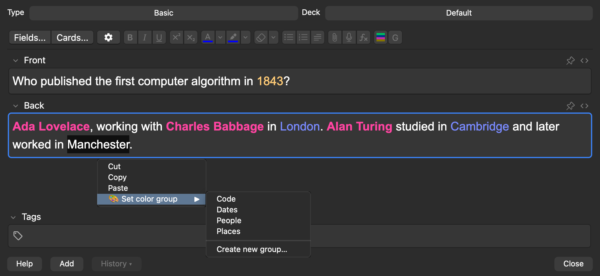
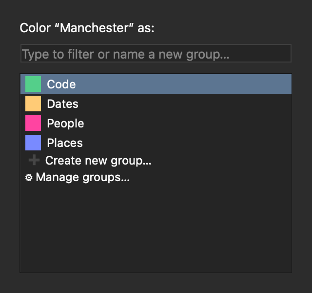
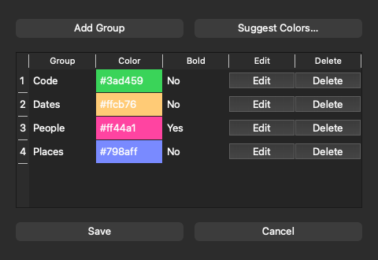
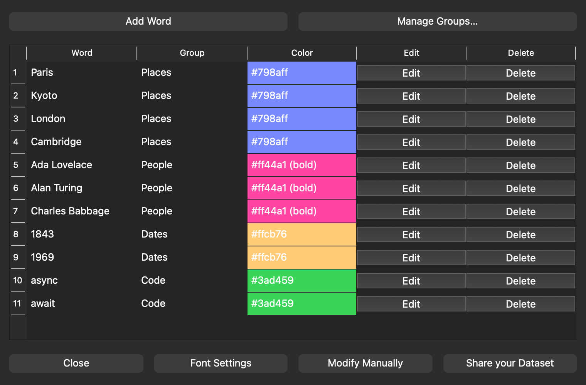
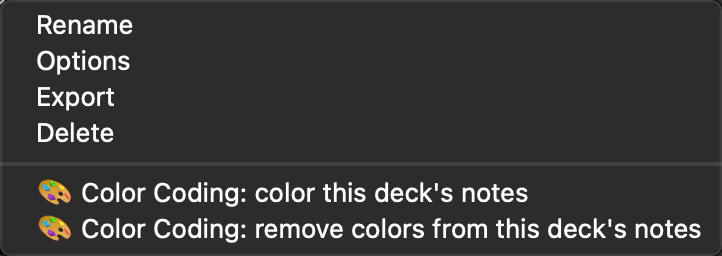
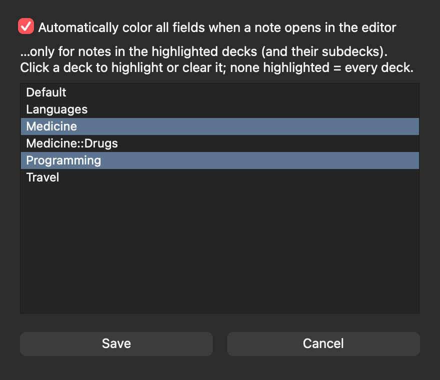

Colours words in your notes **automatically, by group**. Put "Paris" and "Kyoto" in a *Places* group (blue) and "Ada Lovelace" in *People* (pink, bold): every occurrence is coloured as you edit, and changing a group's colour recolours all its words, in every note, without touching them.

*Every word you have put in a group is coloured in every field of the note. The **C** button in the toolbar re-colours; **G** opens the group picker.*

## Features

- **Groups with a colour and a bold flag.** Words belong to a group; the group decides how they look.
- **Group manager** (*Tools → 🎨 Color Coding 🌈 → Manage Groups…*): create, recolour, rename and delete groups.
- **Assign from the editor:** select text, then right-click → *🎨 Set color group*, or press `Meta+Shift+G` for a keyboard-first group picker (Meta is the Control key on macOS and the Windows key on Windows/Linux).
- **Colours every field** of the note, not just the focused one, and again whenever a note is loaded. The **C** button (`Meta+Shift+H`) forces a re-colour.
- **One stylesheet for all the colours.** A coloured word stores its group, not a colour; the colours come from a stylesheet in your collection's media folder. Change a group's colour once and every note follows (on the next card you review; on AnkiDroid and AnkiMobile after a sync).
- **Colour a whole deck at once.** Deck list → gear → *🎨 Color Coding: color this deck's notes* (subdecks included), or select notes in the Browser → *Notes → 🎨 Color Coding: color the words in selected notes*. One undo step (*Edit → Undo*) takes it back.
- **Choose which decks colour automatically** (*Tools → 🎨 Color Coding 🌈 → Font Settings*).
- **Suggested colours:** groups with a similar meaning get similar colours (see below).
- Same markup as the original (``), so existing notes keep working. Old config formats are upgraded automatically.

Requires an Anki build with PyQt6 (23.10 or newer). Developed and used on Anki 26.05.

## Suggested colours

*Manage Groups… → Suggest Colors…* picks colours so that **groups with a similar meaning get similar colours**: Cities, Countries and Rivers in neighbouring blues, Drugs and Diseases in neighbouring greens. You see the result first, untick any group to keep its colour, and nothing is saved until you save the group manager.

How it works: each group's name and a few of its words are turned into an embedding (a list of numbers that places the text by meaning). The add-on finds the shortest closed tour through the groups and walks it around the colour wheel, with a hue step proportional to how far apart neighbouring groups are. Colours are chosen for your current theme (dark or light).

It needs an embedding service that speaks the OpenAI `/v1/embeddings` API:

- **OpenAI:** paste an API key (or start Anki with `OPENAI_API_KEY` set). A run is a few hundred tokens.
- **Ollama (local):** `ollama pull nomic-embed-text`, keep Ollama running, choose *Ollama (local)*. Nothing leaves your computer.
- **Other:** LM Studio, llama.cpp, vLLM... any compatible address, model name and key.

Privacy: only when you press *Suggest*, and only to the address shown in the dialog, the add-on sends the group names and up to 8 words of each group. For a service that is not on your own computer it first shows exactly what it will send and asks. Your notes are never sent. The key is kept in plain text in the add-on's `user_files/settings.json`, readable by your user only.

## Screenshots

**Select a word, right-click, *Set color group*:**

**The group picker** (keyboard only) and **the group manager** (colour and bold per group, and *Suggest Colors…*):

 

**The settings window** (*Tools → 🎨 Color Coding 🌈*) lists every word with its group:

**Colour a deck's notes from the deck list, and choose which decks colour automatically:**

 

## Updating from an earlier version

Notes coloured by an earlier version (or by the original ColorCoding) keep their old fixed colours until they are coloured again: run *color this deck's notes* once per deck (it is one undo step; a backup first never hurts). The first time the add-on colours a note of a given type it adds one `@import` line to that note type's *Styling*; only the styling changes, so Anki does not ask for a full sync.

## Coming from ColorCoding?

Installing this add-on **disables the original ColorCoding** (the two can't run together). Your words live in each add-on's own `user_files/config.json`: copy the original's file into this add-on's `user_files/` folder (*Tools → Add-ons → select → View Files*) to keep them.

## Credits and source

Based on **ColorCoding** by Marc Schubert ([AnkiWeb](https://ankiweb.net/shared/info/2113325087), [GitHub](https://github.com/schubertmc/ColorCoding)). Thank you! Source code, issues and licence details: https://github.com/pointtonull/anki-colorcoding-groups
