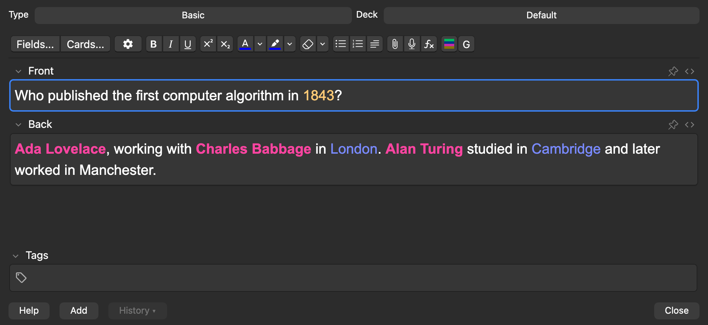
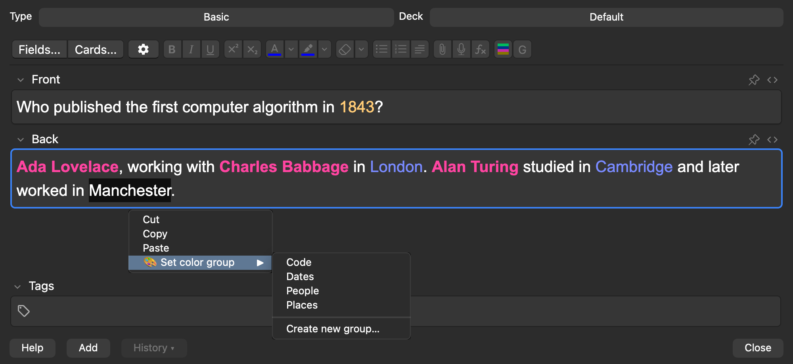
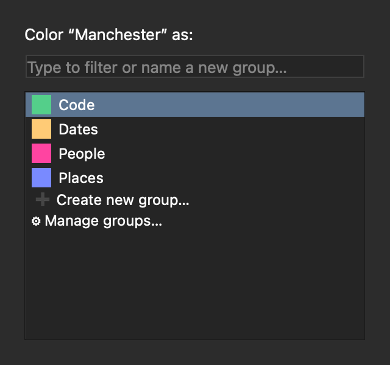
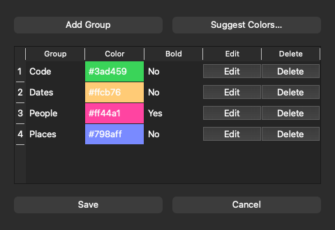
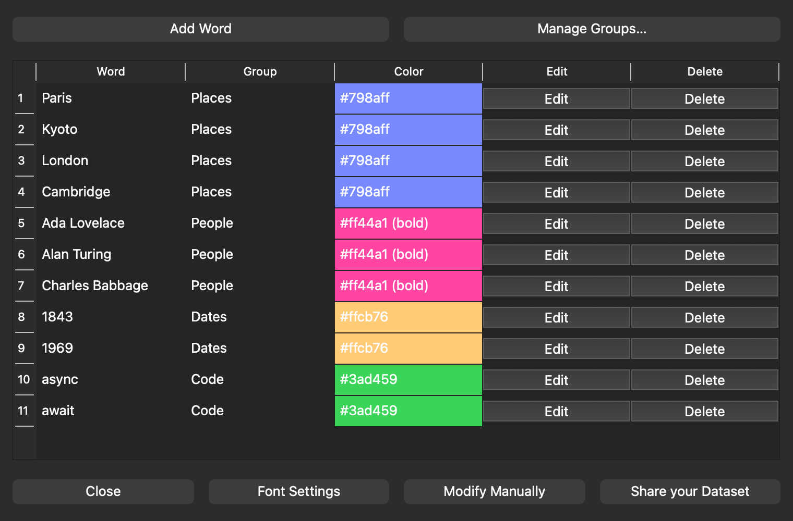
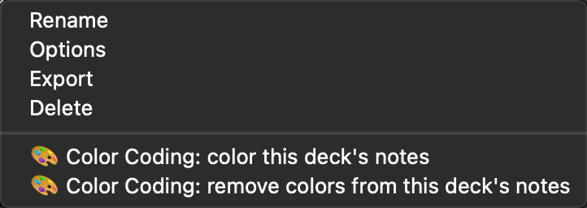
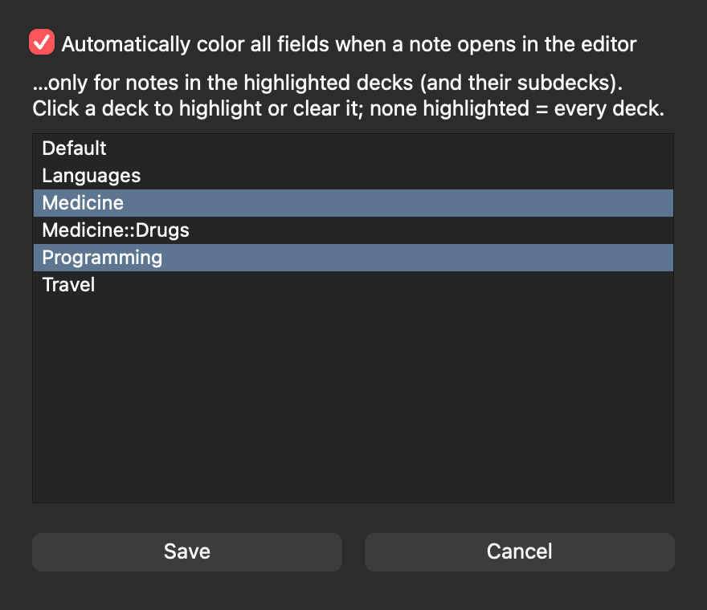
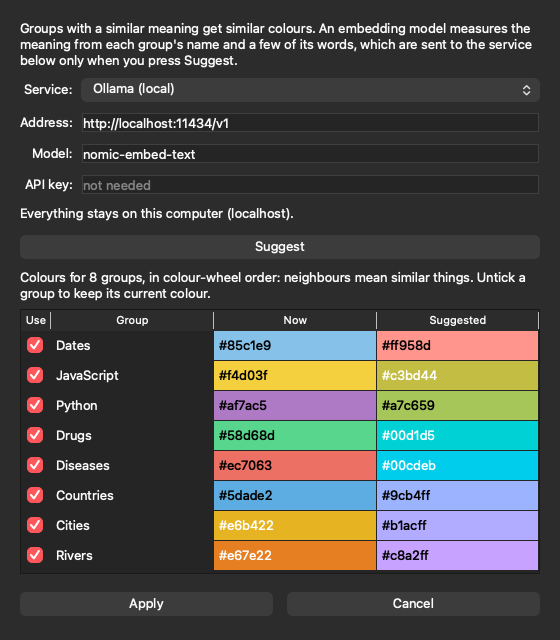

# Color Coding Groups for Anki

An Anki add-on that **colours words automatically, by group**. Put "Paris" and "Kyoto" in a *Places* group
(blue), "Ada Lovelace" in *People* (pink, bold), and every occurrence in your notes is coloured as you edit.
Change a group's colour once and all its words follow.

It builds on [**ColorCoding** by Marc Schubert](https://ankiweb.net/shared/info/2113325087)
([source](https://github.com/schubertmc/ColorCoding)) — see [Credits](#credits-and-licence).



*Every word you have put in a group is coloured in every field of the note. The **C** button in the toolbar
re-colours; **G** opens the group picker.*

## Screenshots

**Right-click a selected word → *🎨 Set color group*** to put it in a group (or create one):



**The group picker** (`Meta+Shift+G`, the physical Control key on macOS) is keyboard-only: type to filter, ↑/↓, Enter.
**The group manager** sets each group's colour and bold flag, and renames or deletes it:




**The settings window** (*Tools → 🎨 Color Coding 🌈*) lists every word with its group and colour:



*The screenshots are made from the add-on's real windows, in a throwaway Anki profile with invented words:
`python3 tools/make_screenshots.py` regenerates them.*

## What it adds

- **Groups with a colour and a bold flag.** Words belong to a group; the group decides how they look.
- **Group manager** (Tools → 🎨 Color Coding 🌈 → *Manage Groups…*): create, recolour, rename, delete groups.
- **Assign from the editor.** Select text and either right-click → *🎨 Set color group*, or press
  `Meta+Shift+G` (the physical **Control** key on macOS) for a keyboard-first group picker.
- **Colours every field** of the note, not just the one with the cursor, and re-colours when a note is loaded.
  The **C** button (`Meta+Shift+H`) forces a re-colour.
- **Change a group's colour once and every note follows**, with nothing to re-open or re-colour: the colours live
  in one stylesheet, not in the notes ([how](#how-the-colours-are-stored)).
- **Colour a whole deck at once.** Deck list → gear → *🎨 Color Coding: color this deck's notes* (subdecks included), or
  select notes in the Browser → *Notes → 🎨 Color Coding: color the words in selected notes*. One undo step
  (*Edit → Undo*) takes it back, and the matching *remove colors* entries strip the colouring again.
- **Choose which decks colour automatically.** *Tools → 🎨 Color Coding 🌈 → Font Settings* turns on automatic colouring
  when a note opens in the editor and lets you limit it to some decks (and their subdecks).
- **Suggested colours.** *Manage Groups… → Suggest Colors…* gives groups with a similar meaning similar colours, using
  an embedding model from OpenAI, Ollama or any compatible service ([how](#suggested-colours)).
- **Config migration:** the flat `[{"word", "group", "color"}]` list of the original and groups stored as bare
  colour strings are upgraded automatically.




## Suggested colours

Choosing a colour per group by hand gets harder the more groups you have, and unrelated colours say nothing about how
the groups relate. *Manage Groups… → Suggest Colors…* picks them for you so that **groups with a similar meaning get
similar colours**: Cities, Countries and Rivers land in neighbouring blues, Drugs and Diseases in neighbouring greens.



You see the result before anything changes: untick a group to keep its colour, press *Apply*, and the colours are
saved with the rest of the group manager (Cancel there throws them away).

**How it works.** Each group's name and a few of its words (`Cities: London, Lisbon`) are turned into an embedding, a
list of numbers that places the text by meaning. The add-on then finds the shortest closed tour through the groups
(a travelling-salesman route, exact up to 12 groups), so that groups that are close in meaning are neighbours, and
walks it around the colour wheel with a hue step **proportional to the distance to the next group**, the step from the
last group back to the first included. Steps never go below 16°, so two near-duplicate groups stay distinguishable. With
more groups than that fits (about 22), neighbours alternate between a lighter and a darker shade as well. Colours are
picked in OKLCH at a fixed lightness for your current theme (so they read equally well on a dark or a light
background); re-run it after switching theme.

**Which service.** Anything that speaks the OpenAI `/v1/embeddings` API:

| Service | Setup |
|---|---|
| **OpenAI** | Paste an API key (or leave the field empty and start Anki with `OPENAI_API_KEY` set). Model `text-embedding-3-small`. A few hundred tokens per run. |
| **Ollama** (local) | `ollama pull nomic-embed-text`, keep Ollama running, pick *Ollama (local)*. Nothing leaves your computer. |
| **Other** | LM Studio, llama.cpp, vLLM, a gateway...: its `/v1` address, a model name and, if it wants one, a key. |

**What is sent, and when.** Only when you press *Suggest*, and only to the address shown in the dialog: the group names
and up to 8 of each group's words. For a service that is not on your own computer the add-on first shows what it is
about to send and asks. Your notes are never sent. The service and the key are remembered in
`user_files/settings.json` (plain text, readable by your user only, never committed); an API key is never sent over
plain `http` to a remote host.

## How the colours are stored

A coloured word is stored as `<span class="ColorCoding" data-name="Paris" data-group="Places">Paris</span>`: the
group, not a colour. The colours come from one stylesheet, `_colorcoding_groups.css`, kept in your collection's media
folder (so it syncs with it) and rewritten whenever you save a group. Each note type pulls it in with a single
`@import url("_colorcoding_groups.css");` line at the top of its *Styling*, which the add-on adds the first time
it colours a note of that type. Only the styling changes, so Anki does not ask for a full sync.

- A colour change shows on the next card you review (the desktop caches a stylesheet for ten seconds); on AnkiDroid
  and AnkiMobile after the next sync.
- Notes coloured by an earlier version (or by the original ColorCoding) carry `style="color:…"` inside each span. That
  keeps winning over the stylesheet until the note is coloured again: run *color this deck's notes* once per deck, or
  open the note with automatic colouring on. Both replace the old spans.
- Uninstalling leaves the `@import` line behind. It is harmless (a missing stylesheet is ignored); delete the first
  line of a note type's *Styling* to tidy up. Spans left in notes show as plain text.
- The add-on also puts the same rules into the editor itself, so coloured words show there too.

The same markup (`class="ColorCoding"`, `data-group`) is what the original add-on wrote, so notes coloured by either
version keep working.

## Install

Anki 23.10 or newer (the add-on imports PyQt6 directly).

1. Install from [AnkiWeb](https://ankiweb.net/shared/info/267803161) (*Tools → Add-ons → Get Add-ons…*, code `267803161`), or from a package
   built from this repo: `git archive --format=zip -o colorcoding-groups.ankiaddon HEAD`, then double-click the file.
   Or copy this folder into Anki's add-ons folder (*Tools → Add-ons → View Files*) as `colorcoding_groups/`.
2. Restart Anki. A **🎨 Color Coding 🌈** entry appears under *Tools*.

The original ColorCoding add-on adds the same menu entry and hooks, so only one can run: installing this one
**disables the original automatically** (its `manifest.json` lists it under `conflicts`). Your words and groups live in
each add-on's own `user_files/config.json`, so to carry them over copy the original's file into this add-on's
`user_files/` (*Tools → Add-ons → select → View Files*). The old flat format is upgraded on first load.

## Your data

Words and groups live in `user_files/config.json` inside the add-on folder (created on first save, ignored by git).
`user_files/config.example.json` shows the format:

```json
{
  "groups":  {"Places": {"color": "#798aff", "bold": false}},
  "entries": [{"word": "Paris", "group": "Places"}]
}
```

*Tools → Color Coding → Modify Manually* edits this JSON in a text box. Entries without a group, or whose group no
longer exists, are not coloured.

## Development

- Unit tests (no Anki needed): `python3 -m unittest discover -s tests`. The word matching, stylesheet and `@import`
  handling live in `colorize.py`; the colour suggestion maths (travelling-salesman tour, proportional hues, OKLCH) in
  `palette.py`; the OpenAI-compatible client in `embeddings.py` (tested against a real HTTP server on localhost). None
  of them imports anything from Anki.
- Checks in a real Anki: `python3 tools/check_in_anki.py` runs the add-on in a throwaway profile (editor, bulk colouring
  and undo, deck scope, what the reviewer renders, the colour suggestion dialog against a fake embeddings server).
  `--addon-folder 267803161` repeats it the way AnkiWeb installs it. `COLORCODING_CHECK_TLS=1` also checks that Anki's
  own Python can reach `api.openai.com` over https (it sends nothing but a dummy word, without a key).
- Releasing (maintainer): `DESCRIPTION.md` is the AnkiWeb listing's text; `python3 tools/release_ankiweb.py` checks, packages
  and publishes the committed tree plus that text, then verifies what AnkiWeb serves (`--dry-run`, `--check`; needs Firefox with
  the FoxMCP extension).
- Screenshots: `python3 tools/make_screenshots.py`. `python3 tools/check_harness.py` proves the two above fail fast
  and clean (with a message and snapshots, no leftover processes) instead of hanging when Anki misbehaves.

## Credits and licence

This add-on started from **ColorCoding** by **Marc Schubert** (© 2022–2024), published on
[AnkiWeb](https://ankiweb.net/shared/info/2113325087) and [GitHub](https://github.com/schubertmc/ColorCoding),
and still contains parts of his code (notably in `changer_static.js` and the settings window). The original
project does **not publish a licence**, so those parts remain his; his copyright lines are kept in the source
files. Everything added here (groups, group manager and picker, context menu, all-fields colouring, config migration,
the shared stylesheet, deck-wise colouring, colour suggestions) is under the [MIT licence](LICENSE).

If you are the original author and would like something changed or removed, please open an issue.
